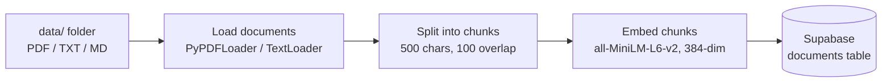
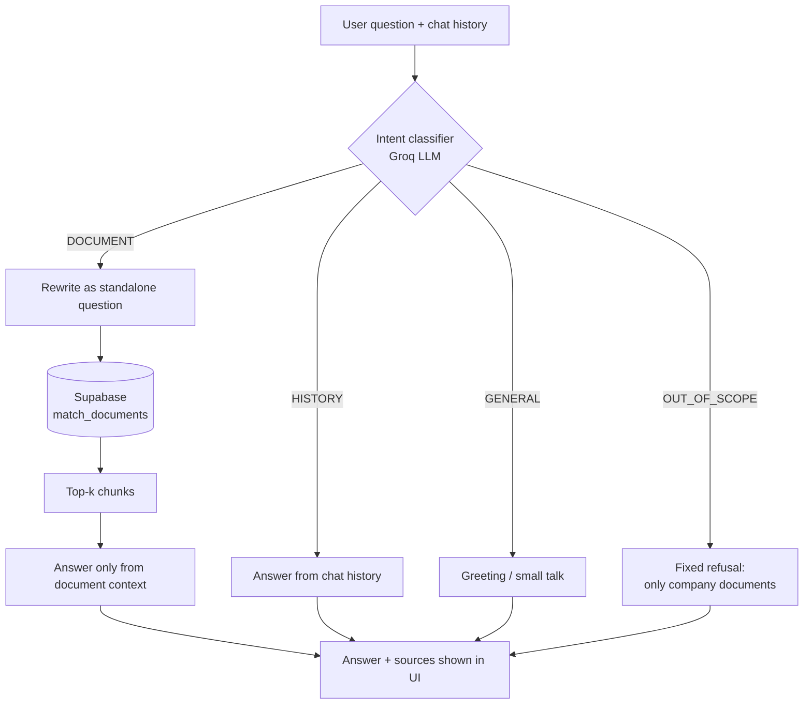

# Conversational RAG Chatbot (Supabase)

A chatbot that answers questions about company policy documents (PDF, TXT, MD).
It searches the documents in a **Supabase** vector store, remembers the conversation,
and refuses questions that are not about the documents.

**Stack:** Streamlit · LangChain · Groq LLM · HuggingFace `all-MiniLM-L6-v2` embeddings · Supabase (Postgres + pgvector)

---

## Workflow

### 1. Ingestion: documents → Supabase



Run with `python ingest.py` or the **Save & rebuild index** button in the app.
Each rebuild clears the table and uploads the documents again.

### 2. Question answering



| Intent | Example | What happens |
|---|---|---|
| `DOCUMENT` | "How many sick leaves do I get?" | Searches Supabase and answers only from the retrieved chunks |
| `HISTORY` | "What was my last question?" | Answers from the conversation |
| `GENERAL` | "Hello" | Short friendly reply |
| `OUT_OF_SCOPE` | "What is Python?" | Refused. The LLM is never asked to answer |

If the documents don't contain the answer, the bot replies *"I don't know based on the provided documents."*

---

## Project structure

```
├── app.py               # Streamlit UI
├── main.py              # Terminal chatbot
├── ingest.py            # Build the vector store in Supabase
├── supabase_setup.sql   # One-time database setup (table + search function)
├── data/                # Source documents
└── src/
    ├── settings.py      # .env config, embeddings, Supabase client/vector store
    ├── ingestion.py     # Load → split → embed → upload
    ├── config.py        # LLM + retriever
    ├── prompts.py       # Intent, rewrite, answer prompts
    ├── chains.py        # LangChain chains
    └── rag_pipeline.py  # Intent routing and answer logic
```

---

## Setup

### 1. Install

```bash
git clone https://github.com/Y-Aravind-Reddy/RAG-Task.git
cd RAG-Task
python -m venv .venv
.venv\Scripts\activate        # Windows  (macOS/Linux: source .venv/bin/activate)
pip install -r requirements.txt
```

### 2. Set up Supabase

1. Create a project at [supabase.com](https://supabase.com).
2. Open **SQL Editor**, paste the contents of [`supabase_setup.sql`](supabase_setup.sql) and click **Run**.
   This turns on pgvector and creates the `documents` table and the `match_documents` function.
3. Recommended: turn on Row Level Security, which blocks access with the public (anon) key. The app's service key skips RLS, so the app keeps working:
   ```sql
   alter table documents enable row level security;
   ```

### 3. Configure `.env`

Copy `.env.example` to `.env` and fill in:

| Variable | Where to get it |
|---|---|
| `GROQ_API_KEY` | [console.groq.com](https://console.groq.com) |
| `SUPABASE_URL` | Supabase → Project Settings → API (e.g. `https://xxxx.supabase.co`, without `/rest/v1/`) |
| `SUPABASE_SERVICE_KEY` | Supabase → Project Settings → API → secret / `service_role` key |

Never commit `.env`. It is already listed in `.gitignore`.

### 4. Ingest and run

```bash
python ingest.py          # upload documents to Supabase
streamlit run app.py      # web app at http://localhost:8501
python main.py            # or chat in the terminal
```

---

## Configuration

All settings are in `.env` (see `.env.example`):

| Variable | Default | Purpose |
|---|---|---|
| `LLM_MODEL` | `openai/gpt-oss-20b` | Groq model |
| `EMBEDDING_MODEL` | `sentence-transformers/all-MiniLM-L6-v2` | Embedding model (384-dim) |
| `CHUNK_SIZE` / `CHUNK_OVERLAP` | `500` / `100` | Text splitting |
| `RETRIEVER_K` | `3` | Chunks retrieved per question |
| `SUPABASE_TABLE` / `SUPABASE_QUERY` | `documents` / `match_documents` | Supabase table and search function |

If you change `EMBEDDING_MODEL`, update `vector(384)` in `supabase_setup.sql` to the new model's dimension, then re-run ingestion.
